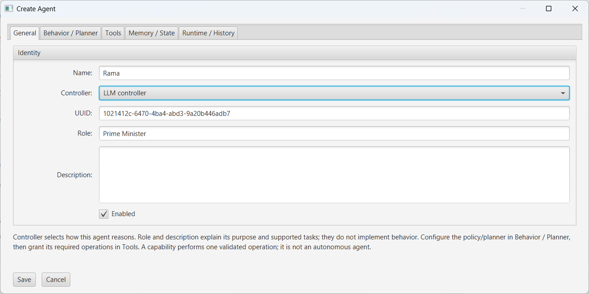
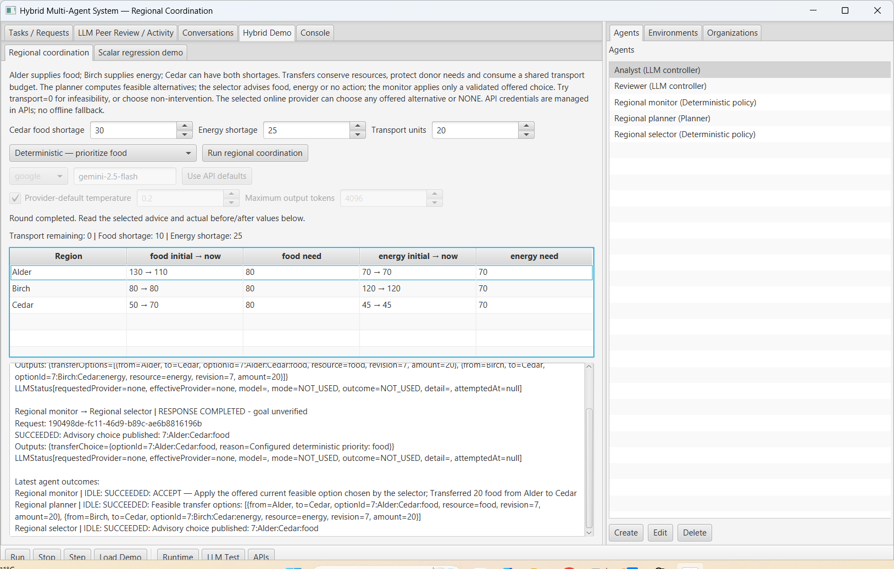
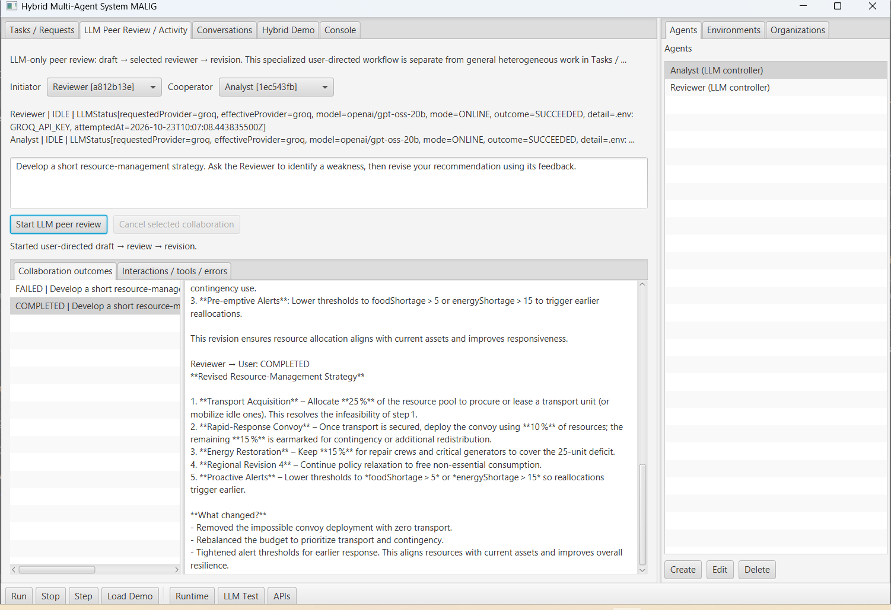
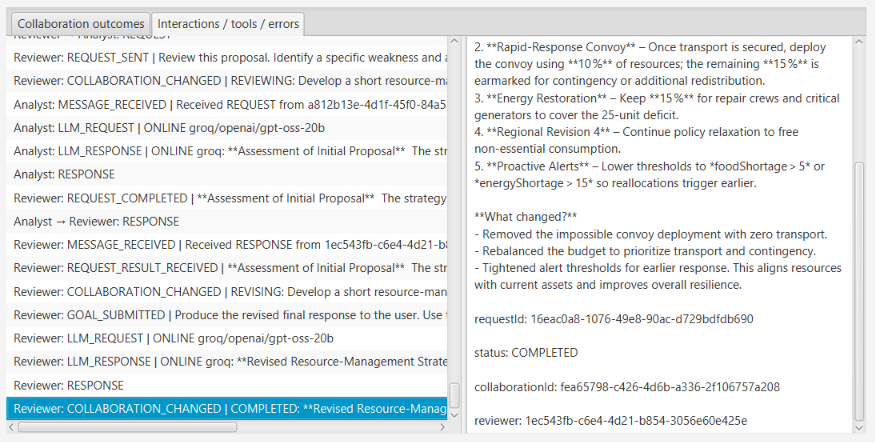
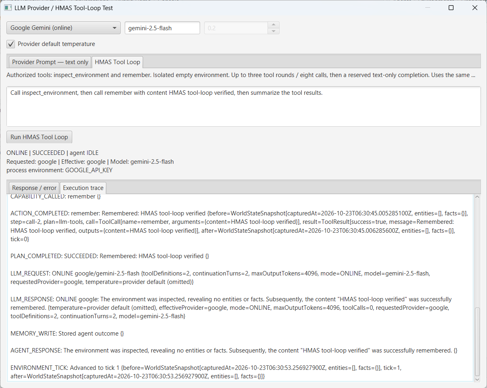
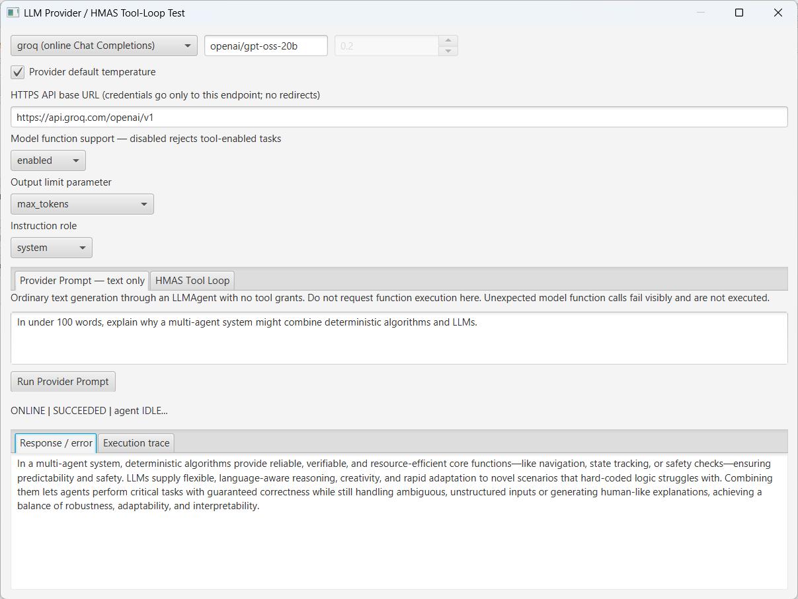
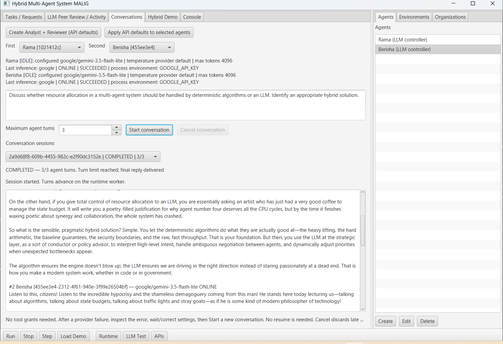

# HMAS — Hybrid Multi-Agent System

**HMAS (Hybrid Multi-Agent System)** is an experimental, modular multi-agent framework developed in **Java and JavaFX** as part of a Master's thesis in Computer Engineering.

The project explores how traditional software agents, algorithmic components, and Large Language Model (LLM) agents can operate within a shared architecture, combining deterministic execution with AI-assisted reasoning, planning, and decision-making.

HMAS is designed as a **research prototype and proof of concept**, emphasizing modularity, extensibility, agent coordination, and execution observability rather than domain-specific applications.

## Architecture

HMAS organizes its functionality into several interconnected components:

| Component | Responsibility |
|---|---|
| **Agents** | Autonomous entities with configurable behaviors, capabilities, and internal state |
| **Environment** | Shared context and state in which agents operate |
| **Interaction** | Communication, requests, cooperation, and delegation |
| **Organization** | Agent grouping, roles, and hierarchical relationships |
| **Tools** | Registered capabilities and controlled function execution |
| **Memory** | Storage and retrieval of agent information and execution context |
| **Planning** | Goal decomposition and selection of execution strategies |
| **Execution** | Task scheduling, plan execution, and result handling |
| **Observation** | Event logging, runtime monitoring, and diagnostics |

The architecture separates agent reasoning from execution mechanisms, allowing different agent implementations to interact through common interfaces.

## Agent Types

HMAS supports different approaches to agent behavior:

- **Rule-based / Deterministic agents:** Execute predefined policies, algorithms, or registered capabilities.
- **LLM-powered agents:** Use language models for reasoning, planning, and tool selection.
- **Hybrid agents:** Combine classical execution logic with LLM-assisted decision-making.

Agents can communicate, request assistance, delegate work, and interact with shared environment resources according to their assigned capabilities and configuration.

## Core Capabilities

### Agent Configuration and Coordination
- Configurable agent profiles, behaviors, and execution settings.
- Agent-to-agent messaging, cooperation, and task delegation.
- Organizational structures and agent relationships.
- Extensible policies and capability registration.

### LLM Integration and Planning
- Integration with multiple LLM providers, including Google Gemini and Groq.
- Tool/function calling through registered capabilities.
- Configurable planning and execution strategies.
- Support for combining LLM-generated decisions with deterministic operations.

### Environment, Memory, and Monitoring
- Shared environments containing resources and state.
- Agent memory and contextual information.
- Execution events, diagnostics, and runtime monitoring.
- Goal, plan, and tool-execution tracking.

### Graphical Interface
A **JavaFX desktop application** provides interfaces for:
- Creating and configuring agents.
- Managing tools, memory, and agent connections.
- Inspecting environments and organizational relationships.
- Submitting goals and observing execution.
- Configuring LLM providers and runtime options.


## Demonstrations

The following screenshots illustrate HMAS's graphical interface and experimental scenarios, including agent configuration, deterministic execution, LLM integration, communication, and coordination.

### 1. Agent Configuration

The JavaFX interface allows users to configure agents, their behavior, connections, tools, memory, and runtime settings.



### 2. Deterministic Multi-Agent Resource Management

A demonstration scenario where agents monitor resources, coordinate decisions, and execute resource-management operations through deterministic policies and registered capabilities.



### 3. Agent Cooperation and Peer Requests

Agents can request assistance from other agents, exchange results, and coordinate execution through the shared runtime.



Execution events and diagnostics provide visibility into agent interactions and task outcomes.



### 4. LLM Integration and Tool Calling

HMAS supports external language model providers and tool/function calling, allowing LLM-powered agents to interact with the environment through registered capabilities.

**Gemini — Tool Execution Loop**



**Groq — LLM Integration Test**



### 5. Multi-Agent Conversations

An experimental scenario demonstrating communication between simulated agents using natural-language interactions.



These demonstrations illustrate individual framework capabilities and experimental workflows. They are not intended to represent a complete production-ready multi-agent system.


## Technologies

- **Java 21** — Core application and agent architecture
- **JavaFX** — Desktop graphical interface
- **Maven** — Dependency management and build system
- **LLM APIs** — External model integration

## Installation and Running

**Requirements:**
- JDK 21+
- Apache Maven
- Internet connection and appropriate API credentials for online LLM functionality (configure .env file in repository root)

Run the JavaFX application:

```bash
mvn javafx:run
```

For **IntelliJ IDEA**, import the project as a Maven project and ensure that the configured JDK is at least Java 21.

If the IDE has issues launching the JavaFX application directly, use `mvn javafx:run` from the terminal.

## Development Status

**Status: Research Prototype - Active Development**

The project currently focuses on validating the fundamental architecture and interactions between classical and LLM-powered agents.

Some advanced mechanisms, including additional planning algorithms, long-term memory strategies, dynamic extensibility, and distributed execution, remain areas for further development.

HMAS is not intended to replace established multi-agent frameworks, but to provide an experimental platform for investigating hybrid agent architectures and their practical integration.


